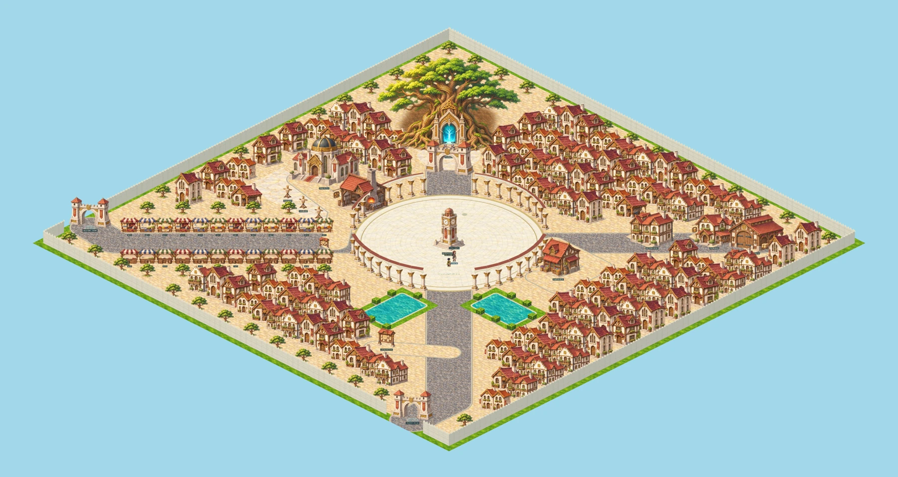

# Central — City of Beginnings

Central is rebuilt around the supplied city sketch: a large circular arrival/healing plaza and clock tower; a western market street; pools and planted borders beside the southern avenue; a quest board; a smithy and high council court with practice dummies; northern residential blocks and an arch into the World Tree forecourt; the cyan dungeon portal inside Yggdrasil; and two outer city gates.

## Shared city plan

`shared/central-layout.ts` owns the 80×80 city dimensions, plaza, explicit roads, healing radius, gates, spawn, NPC locations and market slots. `shared/central.ts` places monuments and deterministic housing blocks around those routes. Road paving is drawn from this plan, not from a collection of BFS traces. Collision, service approaches and rendering use the same map data.

The central circle has radius 12.4 world units. Every living player inside it recovers HP 6% and MP 10% of their maximum per second, including the spawn area. The old extra spawn regeneration is disabled for Central so the rate is uniform. The clock foundation is solid; the remaining plaza is open. Eira stands near the clock and three additional NPC spots are reserved as small pavement inlays.

The colonnade has 48 potential segments, with four broad openings aligned to the avenues. Pillar colliders are registered to walk-grid cells so continuous movement cannot cut through a thin post between path nodes. The city has 123 decorative homes, 24 market stalls and planted streets/garden edges. Every home doorway, service and both gates is reachable.

The two city exits both connect to the existing Central Commons through distinct return approaches. The northern tree entrance retains the server-validated two-guard conversation and confirmation; neither walking into the doorway nor NPC warp bypasses it.

## Architecture and rendering

Original painted city art is packed into 25 sprites: monuments, red-awning supplies shop, smithy, housing variants, front/rear market stalls, tree, seating, board, dummy, gate and pillar. Opposing market rows have distinct front/back paintings; lighting is not mirror-flipped to simulate a rotation. Architecture uses one consistent camera/palette, and building bases are anchored at projected lot-front corners.

The pavement plan is painted in world coordinates and projected once with the same 2:1 isometric transform as characters and collision. Round paving, road widths, ponds, colonnade arcs and city walls therefore share one projection. Marble stone courses and block joints follow the plaza circle. A softened alpha mask blends soil below Yggdrasil into paving without an abrupt round or star-shaped cutout.

Tall objects sort by ground position and fade when they obscure the player. The forecourt arch uses a lighter fade than ordinary buildings. Portal motes/glow animate at the tree entrance. Zoom can go down to 0.14 in Central for a whole-city view; other maps retain their previous zoom range.

The runtime city atlas is 2048×2048 (16 MiB RGBA); the ground texture is 3840×1920, below the 4096 texture-axis limit. Surfaces are 768×512. This is a desktop-first city; mobile browser checks cover layout/overflow, not a claim of final mobile performance tuning.

## Functional locations

- Eira: guidance and the existing one-time starter pack.
- Red-awning supplies shop: real basic-item purchase/sale through the inventory shop, with server range and price checks.
- Inn and waygate: existing save-town and discovered-map travel services.
- Straw dummies: click to perform a practice strike with the equipped weapon, server cooldown and MP checks. Damage resolves at the normal hit time; no EXP, kills, money or loot are awarded. Dummies are props, so no city monsters are spawned.
- Council, smithy, warehouse and quest board: named, reachable city locations. Player crafting, quest-board content, house interiors, stall rentals and the three future NPCs remain their respective future systems; their city sites are prepared without pretending those systems are already complete.

## Saved characters and items

Layout version 2 relocates a character saved in the old Central to the new arrival once. Identity, appearance, level, stats, money, equipment and inventory are preserved. Saved ground items from the old Central are also moved to the new arrival with the same instance IDs and original expiration times, so rebuilding does not strand or recreate an item inside a building. Current-layout saves retain their normal positions. Main-quest/world-boss state is retained.

## Reproduction and checks

`npm run art:central` normalizes the original source art in `docs/art/central-v2/` and packs complete silhouettes; semi-transparent background mattes are removed while painted RGB is preserved. `npx tsx scripts/export-central-layout.ts` exports the readable coordinate plan to `docs/world/central-layout-v2.json`.

`npm test` verifies traversal, all services/doorways, full-plaza healing, data migration, practice restrictions and existing gameplay. `npm run test:central-v2` uses an isolated real server/database and Chromium to check ten districts, actual Eira/shop/guard interaction, training and both gate round trips. Screenshots are saved to ignored `artifacts/central-v2/`. `test:central` runs the same current tour through its existing entry point. Item/inventory and guard browser suites are run as regressions.

Verified for this revision: production build passed; 118 unit tests passed; the ten-district browser tour and inventory/guard browser regressions passed without page errors or missing assets. The final arrival, tree and practice-court views were checked again after visual refinements.

