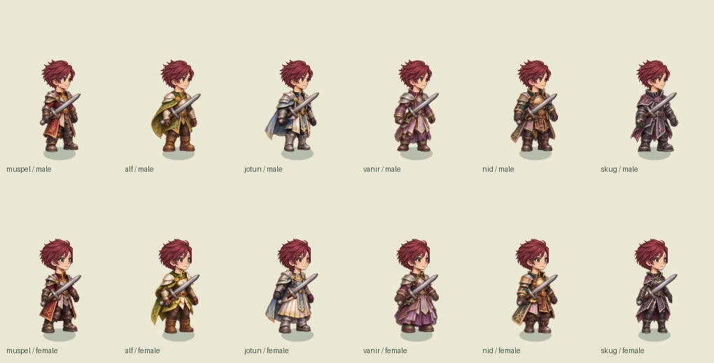
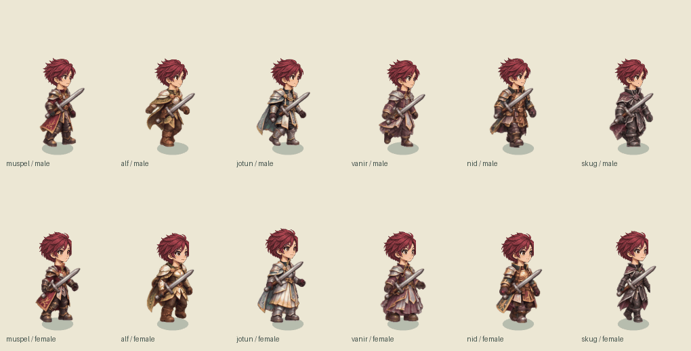
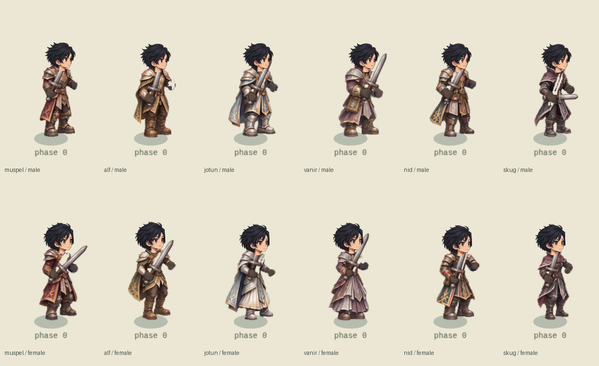

# Final-tier outfits and HD modular heads

Twelve original final-tier costume designs cover the six current race/role families, with male and female cuts. The collection now includes **2,304 painted whole-body frames: 12 outfits × 8 directions × 24 poses**, attached to the live character renderer, inventory preview and GM workshop. The original three-view design catalog remains available for comparing materials and silhouettes.

| Race / role | Set | Palette and silhouette |
| --- | --- | --- |
| Muspelborn / swordsman | Ember Crown Vanguard | Charcoal steel, crimson split mantle, silver edges; heavy overlapping shoulders |
| Ljosalfar / archer | Dawnleaf Sentinel | Emerald, moss, ivory and pale gold; light leaf plates and short shoulder mantle |
| Jotunborn / healer | Glacier Covenant | Pearl, glacial silver, navy and pale gold; ceremonial tabards and pleated panels |
| Vanirkin / mage | Worldroot Arcanist | Plum, lavender, muted silver and turquoise; high collar, layered robe tails and folio |
| Nidavellir / merchant and runesmith | Auric Forgemaster | Bronze, petrol teal, chestnut leather and steel; divided tool apron and reinforced boots |
| Skuggar / thief | Eclipse Wayfarer | Obsidian, indigo, wine-purple and silver; fitted light armor and asymmetric coat tails |

The five supplied references inform construction: the black high-collar swordsman coat, articulated dark silver knight plates, lavender ceremonial tabard, blue/silver panels, and gold/blue mantle with white pleating. These are combined and recolored for each role, with original root, leaf, snow and knot motifs. Both genders retain protective clothing, visible arms and boots, with different waist, coat and robe construction.

## Animation and attachment

| Pose IDs | Motion |
| --- | --- |
| 0–1 | Idle and breathing |
| 2–5 | Alternating walk contacts and passing steps |
| 6–11 | Slash windup, contact, follow-through, reverse cut, thrust and overhead |
| 12–13 | Spell gather and release |
| 14–15 | Hurt and fallen |
| 16–19 | Bow ready, nock, full draw and release |
| 20–23 | Two-handed ready, overhead, contact and recovery |

Bodies are complete painted frames; the renderer does not stretch limbs or rotate torso pieces to manufacture actions. Walking selects the phase from actual distance traveled. Existing server hit times and attack-speed combo sequencing select the appropriate contact/recovery frames. Weapon art remains separate, preserving the existing white/blue catalog skins.

Each frame has a neck socket and anatomical palm registration. Glove patches cover the handle at the grip; two-handed hilt contacts use adjacent palms. Source marker omissions and rejected costume pixels are recorded in `public/art/final-frames/registration-report.json`; these are registration notes, not extra painted frames. Missing hints are registered against the existing approved pose layout and the new painted silhouette. Collar detection uses the actual top collar pixels; zero-padded cell cleanup prevents a neighbouring boot fragment from shifting the neck upward. `scripts/check-final-art.py` checks all 576 idle/walk collar contacts against the packed pixels and guards against cell-edge wraparound. A reviewed source-coordinate override fixes the upper-edge cyan dot on the front Jotun female overhead frame. Rear cloth occlusion hides grips that belong in front of a back-facing torso. Heavy-weapon recovery chooses the upright hilt orientation. The shared relaxed offhand floor-clearance calculation now accepts Phaser's equivalent wrapped negative angles, fixing rear dual blades that previously flared horizontally.

## HD heads

Eighty newly painted directional heads cover five hairstyles × two genders × eight views. Face shading, hair locks, eyelashes, irises and mouth detail are repainted rather than enlarged from the old runtime images. Source faces share a consistent scale within each gender; separate face/neck registration avoids letting hair volume resize the face.

Heads are packed in 384×384 source frames, displayed in the same 96-world-pixel registration space. Face, front hair, back hair, iris and eyelids remain separate. Existing hairstyle, six hair colors, five eye colors, blink/hurt expressions and fallen orientations continue to work. These heads are used by starter and final outfits in the creator, HUD portrait, inventory, world and workshop. The independent layers let long hair sort around the body while the neck overlaps the collar.

## Testing in game

1. Open **GM tools → outfit test → final-class outfit → equip in map**. The selection persists across reloads. Choose starter to revert.
2. Open **GM tools → character workshop** and select the final outfit tier, race, gender, action and weapon. Automatic playback runs real animation timing. The reference-frame selector can hold any pose 0–23 for inspecting palms, collar and weapon layering.
3. The design catalog's **inspect this outfit's animation** button opens the actual renderer with the selected race and gender.

The GM outfit selection is cosmetic: it does not alter level, attributes, equipment, item ownership, money or combat bonuses. The server validates the GM role and tier and audits the operation. Ordinary account creation cannot inject this field. These set names remain proposed final-tier visual identities; this update does not introduce job advancement or ordinary-player unlock rules.

## Assets and reproduction

- `docs/art/final-outfits/`: approved three-view design sources and comparison images.
- `docs/art/final-frames/`: 18 painted base animation sheets, including independently painted left-facing views, and the registration override.
- `docs/art/final-holding/`: 12 dedicated bow/two-handed sheets.
- `docs/art/heads-hd/`: four high-detail modular head sheets and a registered preview.
- `npm run art:final-animation` packs body/hands atlases, exports `shared/final-animation.json` and checks collar contacts.
- `npm run art:heads-hd` separates and registers head layers and exports `shared/heads-hd.json`.
- After the browser render tour, `npm run art:final-previews` exports the in-engine lineup and walk/combat GIF loops.
- Packing needs Python, Pillow and NumPy; SciPy is an optional faster component-labeling path. Players use the shipped WebP files and do not need Python.

Every outfit atlas is 2048×2048 (16 MiB RGBA), loaded only when that race/gender final outfit is encountered. The twelve cached outfits total 192 MiB if all are loaded. The two HD head atlases are 2048×4096, 32 MiB each. No texture axis exceeds 4096. Mobile layout checks are not a claim of final mobile GPU/memory optimization.

## Verification

Verified on this revision: production build passed, 122 unit tests passed, all 2,304 body frames rendered with joined head/hilt contacts, 576 idle/walk collars passed pixel checks, and the authenticated real-game equip/walk/inventory/workshop/reload/combat/revert tour passed without page errors or missing assets.

- Unit tests check every frame's registration, visible main grips, adjacent two-hand grips, texture limits, HD layers, save/revert behavior and GM authorization.
- `npm run test:final-animation` renders all 2,304 frames through the actual Phaser `HeroRig`; checks registered head and both hilt contacts, zero body-joint rotation, three expressions, and missing assets/page errors. `--carries` reviews rear/side shield, staff and dual-blade carries.
- `npm run test:final-outfit-game` uses an isolated real GM account/server to equip, walk, inspect inventory, use the animated workshop, reload, attack in a field and revert without changing progression.
- Screenshots are written to ignored `artifacts/final-animation/` and `artifacts/final-outfit-game/`.

