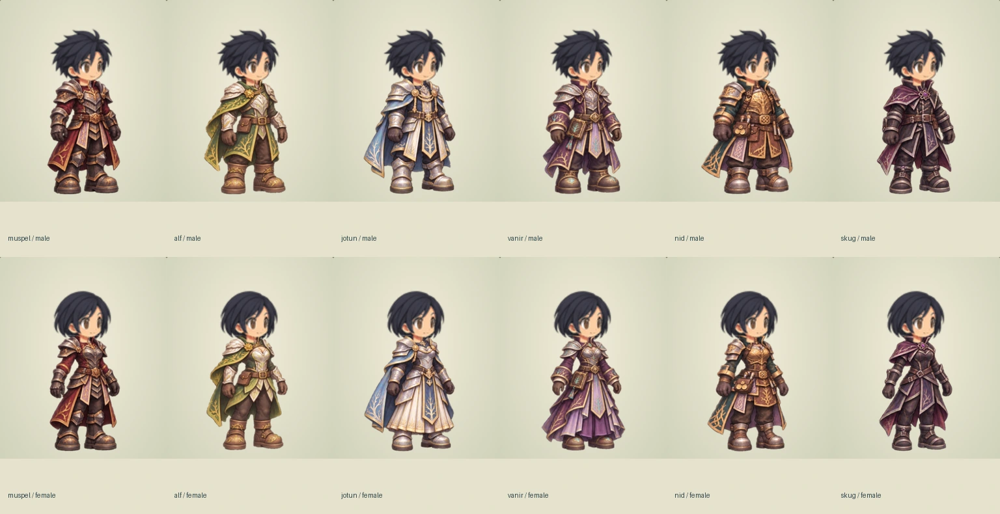
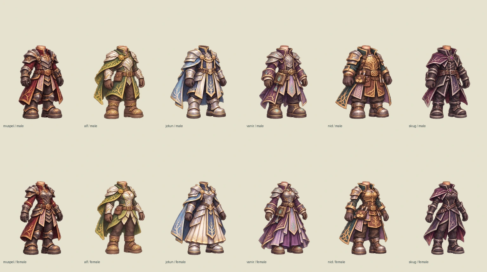

# Final-tier outfit design collection

Twelve original costume designs cover the six current race/role families, with male and female cuts. Each design has a separately painted front three-quarter, right-side and back turnaround: 36 static body paintings in total. The names describe proposed final-tier visual identities, not implemented job advancement trees.

| Race / role | Set | Palette and silhouette |
| --- | --- | --- |
| Muspelborn / swordsman | Ember Crown Vanguard | Charcoal steel, crimson split mantle, silver edges; overlapping heavy shoulders |
| Ljosalfar / archer | Dawnleaf Sentinel | Emerald, moss, ivory and pale gold; light leaf-shaped plates, short shoulder mantle |
| Jotunborn / healer | Glacier Covenant | Pearl, glacial silver, navy and pale gold; ceremonial tabards and pleated robe panels |
| Vanirkin / mage | Worldroot Arcanist | Plum, lavender, muted silver and turquoise; high collar, layered robe tails, folio |
| Nidavellir / merchant and runesmith | Auric Forgemaster | Bronze, petrol teal, chestnut leather and steel; divided tool apron, reinforced boots |
| Skuggar / thief | Eclipse Wayfarer | Obsidian, indigo, wine-purple and silver; fitted light armor, narrow asymmetric coat tails |

The supplied five images inform construction: the black high-collar swordsman coat, dark silver articulated knight plates, lavender ceremonial tabard, blue/silver armored panels, and gold/blue royal mantle with white pleating. These are combined and recolored for each role, with original root, leaf, snow and knot motifs replacing the source characters' insignia. No reference character, crest or weapon is imported. Both genders retain practical protection, visible arms and boots; different waist/coat/robe construction makes them more than palette swaps.

## In-game inspection

Open **GM tools → character workshop → final-class outfit designs**. Select a race, gender, hairstyle and hair color. Three directions appear together. “Body only” isolates the headless costume. This is a local read-only design catalog, not a character editor; closing it preserves the live hero, stats, equipment, money and inventory. Existing modular head art is composed above each costume, so hair and head are not baked into armor.

## Asset contract

- `shared/final-outfits.ts` owns stable design IDs, palettes, materials, gender differences and safe asset paths.
- Source sheets in `docs/art/final-outfits/`: three equal columns (front/side/back), two rows (male/female).
- `npm run art:final-outfits` removes the generated low-opacity background matte and registers complete bodies into transparent 256×384 images. One scale is shared across the three views of each design. Neck socket `(128,144)` and boot baseline up to `376` match the existing head composition space.
- Runtime images and a readable manifest live at `public/art/final-outfits/`.
- This collection is **static turnaround design art**. It does not replace starter clothes, add armor stats, award endgame equipment, or claim eight-direction walking/weapon/combat frames. Shipping these as wearable animated outfits requires painting and registering the remaining directions and action frames against the current weapon palms and head sockets, then implementing the final-job unlock rules.

## Validation

`npm run test:final-outfits` creates an isolated GM account and real server. It checks all 36 distinct previews and image loads, real head customization, body isolation, two mobile viewport sizes, return navigation, and preservation of the live character. Screenshots go to ignored `artifacts/final-outfits/`.

Verified: production build and all 118 unit tests passed. The real-browser catalog test passed all 36 views with no missing assets or page errors, and the existing animation-workshop smoke test passed.

