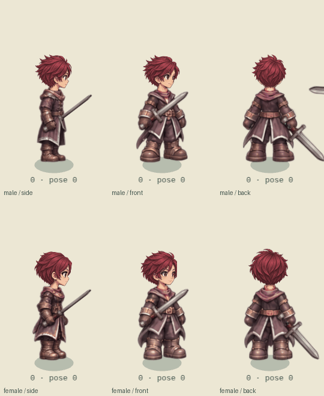
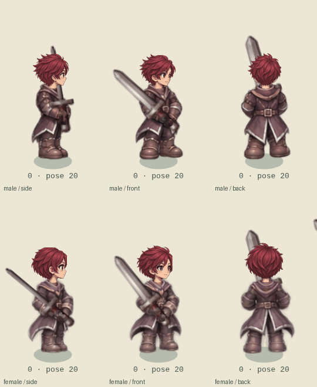
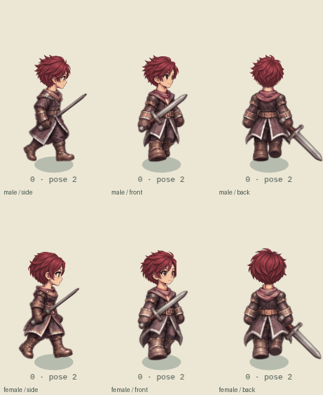

# Starter outfit attachment and motion review

This review covers the twelve starter outfits (six races, both genders), including side/rear views. The starter renderer still uses the existing independently painted 16 body poses plus 8 bow/two-hand poses. This change does not turn those sources into the new eight-phase final-tier strips.

Findings and corrections:

- All 2,208 standing collar registrations touch actual packed cloth. Head rotation was nevertheless always zero. A new offline registration measures the waist/core silhouette below the forearms and estimates a small torso roll, capped at 0.22 radians. The head follows this roll about its real nape; body artwork is not rotated or stretched.
- Starter heads now use a common 0.90 scale at the nape in both the live rig and SVG portraits. The existing three-world-pixel collar overlap remains.
- Heavy-weapon orientation previously depended on whether the current clock had crossed the hit time. Pose 23 can occur in both windup and follow-through, so identical painted fists could receive opposite blade directions. The direction now depends on the painted pose. Both hilt contacts still coincide with the same registered palms.
- Starter attack recovery could select a fresh windup before the next attack began. Both normal and heavy/bow clips now finish in their guard.

The remaining limitation is visible in the temporal samples: some starter attacks still jump between independent poses, and some intermediate body/hand silhouettes would need repainting to match the final-tier continuous tracks. Numeric contact equality does not establish anatomical correctness, and this review does not claim a full starter animation redraw.

Reproduce registration with `npm run art:starter-registration`. Run `npm run test:starter-continuity` for real-time samples and a same-pose hit-boundary regression across eight directions and three attack speeds. `npm run test:weapon-holding` checks all weapon profiles and catalog skins. `python3 scripts/export-starter-previews.py` exports the unretouched renderer samples below.

Validation: production build and 127 unit tests passed; the temporal browser review checked 1,152 samples over all twelve outfits, three representative views, and sword/heavy/bow/walk actions. The same-pose hit-boundary regression covers all eight directions at 300/740/1,200 ms intervals. The equipment regression covers 17 profiles and 96 catalog skins. No page errors or missing art were reported in these completed tours.
